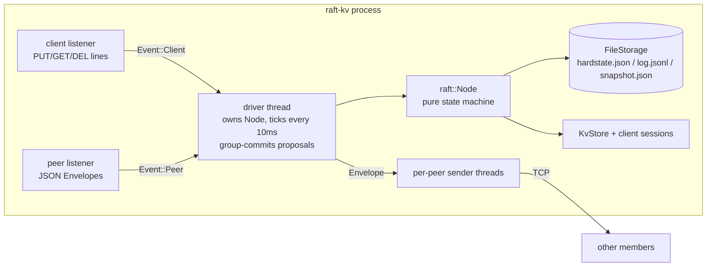
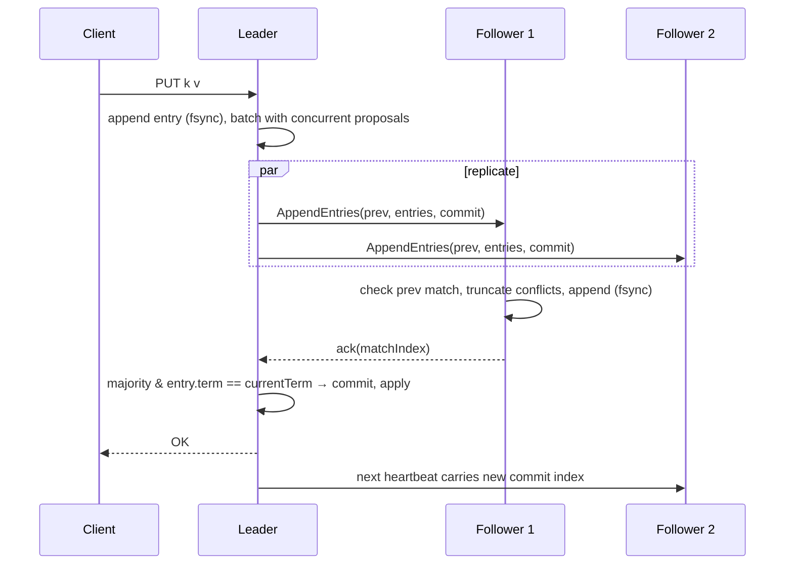

# raft-kv

[](https://github.com/anirudhpundhir/raft-kv/actions/workflows/ci.yml)

A Raft-replicated key-value store in Rust: leader election, log replication, the commit rule, durable state, snapshots with `InstallSnapshot`, and exactly-once client sessions. The consensus core is a **deterministic state machine**. It's tested in a seeded **network/crash simulator** that checks Raft's safety invariants on every tick, and **every run's client history is checked for linearizability**.

- **Pure core**: `tick()`, `step(msg)` and `propose()` in; messages and applied entries out. The same code runs in simulation and over TCP.
- **Simulation**: partitions, message loss, reordering and delays, crash/restart from durable state, and a random nemesis that targets the leader. Any failure replays from its seed.
- **Checked properties**: election safety, state machine safety, liveness after healing, convergence, and **linearizability** (Wing–Gong checker).
- **Figure 8**: a hand-scheduled reproduction of the paper's Figure 8 proves the "only commit current-term entries" rule is load-bearing.
- **Real binary**: TCP peer transport, a line-protocol client API, fsync'd file storage with torn-tail repair, and group commit.

## Architecture





Layout:

```
src/raft.rs              consensus core (election, replication, commit, snapshots, check-quorum)
src/storage.rs           Storage trait, MemStorage (sim), FileStorage (fsync, atomic renames, torn-tail repair)
src/kv.rs                replicated state machine + exactly-once sessions
src/sim.rs               deterministic simulator, nemesis, invariant checks
src/linearizability.rs   Wing–Gong checker (per-key, memoized)
src/server.rs, main.rs   TCP transport + client protocol + binary
tests/simulation.rs      seeded scenarios (crash failover, isolated leader, chaos, snapshots, 3-node heavy loss)
tests/figure8.rs         Raft paper Figure 8, hand-scheduled
tests/cluster.rs         3 real processes: failover + full-cluster restart durability
examples/                loadgen, sim_stats
docs/DESIGN.md           ADRs: determinism, persistence ordering, safety rules, reads, flow control
```

## Quick start

```bash
make cluster      # 3 nodes on localhost: peers :7001-7003, clients :8001-8003
```

```console
$ printf 'PUT greeting hello\n' | nc localhost 8001
REDIRECT 2 127.0.0.1:8002
$ printf 'PUT greeting hello\nGET greeting\nDEL greeting\nGET greeting\n' | nc localhost 8002
OK
VALUE hello
OK
NIL
```

Kill the leader and the remaining two elect a new one within a few hundred ms (the election timeout is 300–600ms in the binary). Restart every node and the data is still there (`tests/cluster.rs` does exactly that).

## Testing

```bash
make test                   # unit + simulation (default seed ranges) + Figure 8 + 3-process cluster
make sim-soak SEEDS=1000    # 1000 seeds per scenario (~10s release build on the dev box)
RAFT_SIM_SEED=1234 cargo test --release --test simulation chaos   # replay one seed
cargo run --release --example sim_stats -- 3 3000                  # inspect one run
```

One run from `sim_stats` (seed 3, 3000 ticks, 5% loss): 27,699 messages, 2,523 dropped, 12 elections, 11 crashes, 9 partitions, 10 snapshot installs, 432 client ops, all linearizable.

The tests were also checked against hand-made mutants (see ADR-005). Every single-line safety bug tried is caught by at least one test.

## Benchmarks

`examples/loadgen` is a closed-loop load generator: each connection sends `PUT` and waits for `OK`. Every op is fsync'd on the leader and on a majority before it's acknowledged.

Measured on the build box: **8 vCPU Intel Xeon (virtualized), 15 GiB RAM, ext4 on virtio disk (`fdatasync` of a small append ≈ 0.13ms), Linux, rustc 1.85.1 release build, 3 nodes on the same host over loopback.** This shows how the implementation behaves on one machine. It isn't a distributed-deployment claim. The table shows three consecutive runs.

| Connections | Ops | Throughput (ops/s) | p50 | p99 |
|---:|---:|---:|---:|---:|
| 1 | 2,000 | 3,291 / 2,372 / 2,412 | 0.27–0.39 ms | 0.75–1.57 ms |
| 16 | 8,000 | 8,857 / 7,727 / 6,973 | 1.29–1.47 ms | 6.5–8.7 ms |
| 64 | 32,000 | 24,245 / 23,152 / 23,382 | 1.75–2.12 ms | 6.6–9.6 ms |

Max latencies of ~160ms at 64 connections show up consistently in these runs. The source hasn't been investigated; likely candidates are batch-size spikes and scheduler contention between 3 nodes and 64 client threads on 8 vCPUs.

## License

MIT
